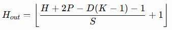
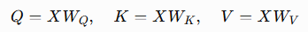
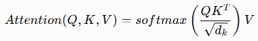
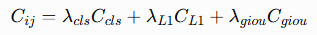
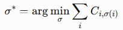
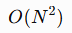
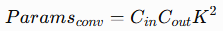

# 引言

我建议做成  **24 课、6 个阶段的一套 DEIMv2 源码课程** 。这样既能照顾视觉算法初学者，又能把你最关心的 `deim_dfine_x`、`deimv2_dinov3_x` 和 DEIM/DEIMv2 训练优化真正拆透。

我已经按当前官方 [DEIMv2 GitHub 仓库](https://github.com/Intellindust-AI-Lab/DEIMv2?utm_source=chatgpt.com)、[DEIMv2 论文](https://arxiv.org/abs/2509.20787?utm_source=chatgpt.com) 和原始 [DEIM 论文](https://arxiv.org/abs/2412.04234?utm_source=chatgpt.com) 重新核对。当前仓库顶层主要是 `configs/`、`engine/`、`tools/`、`train.py` 等；官方模型覆盖 Atto→X 八档，其中 S/M/L/X 是 ViT/DINOv3 路线，轻量型号则包含 HGNetv2 路线。

而且你指定的两个模型非常适合做课程的两条主线：

<pre class="overflow-visible! px-0!" data-start="457" data-end="812"><div class="relative w-full mt-4 mb-1"><div class=""><div class="contents"><div class="relative"><div class="h-full min-h-0 min-w-0"><div class="h-full min-h-0 min-w-0"><div class="border border-token-border-light border-radius-3xl corner-superellipse/1.1 rounded-3xl"><div class="h-full w-full border-radius-3xl bg-(--code-block-surface) corner-superellipse/1.1 overflow-clip rounded-3xl [--code-block-surface:var(--bg-elevated-secondary)] dark:[--code-block-surface:var(--composer-surface-primary)] lxnfua_clipPathFallback"><div class="pointer-events-none absolute end-1.5 top-1 z-2 md:end-2 md:top-1"></div><div class="relative"><div class="pe-11 pt-3"><div class="relative z-0 flex max-w-full"><div id="code-block-viewer" dir="ltr" class="q9tKkq_viewer cm-editor z-10 light:cm-light dark:cm-light flex h-full w-full flex-col items-stretch ͼd ͼr"><div class="cm-scroller"><pre class="cm-content q9tKkq_readonly m-0"><code><span>主线 A：deim_dfine_x
Image
  ↓
HGNetv2
  ↓
multi-scale features
  ↓
HybridEncoder
  ↓
DFINETransformer
  ↓
D-FINE box representation / refinement
  ↓
DEIM training framework
  ↓
boxes + classes

主线 B：deimv2_dinov3_x
Image
  ↓
DINOv3 ViT-S+
  ↓
STA
  ↓
1/8, 1/16, 1/32 multi-scale features
  ↓
HybridEncoder
  ↓
DEIMTransformer
  ↓
boxes + classes</span></code></pre></div></div></div></div></div></div></div></div></div><div class=""><div class=""></div></div></div></div></div></div></pre>

第二条正是 DEIMv2 的核心升级路线。官方 X 配置使用 `dinov3_vits16plus`、`interaction_indexes=[5,8,11]`、256 hidden dimension、6 decoder layers，并使用三层 `[256,256,256]` 特征。

---

# DEIMv2 从零到源码：24 课完整课程

每一课以后都固定采用同一套学习方式：

**直觉 → 数学 → 网络结构图 → 官方源码 → 逐行解释 → Tensor shape → PyTorch 最小实验 → 回到 DEIMv2 → 本课练习。**

也就是说，我们不会出现“知道 attention 是什么，但打开源码还是看不懂”的情况。

---


## 第一阶段：先获得读懂 DEIMv2 所需的全部基础

### 第 1 课：从一张图片到目标检测——先建立整套地图

这是零基础真正的第一课。

先不碰复杂 Transformer，而是回答最重要的问题：

```
[B, 3, 640, 640]
        ↓
     Backbone
        ↓
feature maps
        ↓
     Encoder
        ↓
multi-scale features
        ↓
     Decoder
        ↓
300 object queries
        ↓
class + bbox
        ↓
最终检测结果
```

会学习 image、pixel、channel、feature map、stride、receptive field、bounding box、classification、localization、backbone/neck/head/encoder/decoder 分别是什么意思。

第一次进入真实入口：

```
# train.py
cfg = YAMLConfig(...)
solver = TASKS[cfg.yaml_cfg['task']](cfg)
solver.fit()
```

然后追踪到 DEIM：

```
x = self.backbone(x)
x = self.encoder(x)
x = self.decoder(x, targets)
```

官方 DEIM 的模型容器本身实际上非常简单，真正的复杂度藏在三个模块里面。

 **实验：** 自己写一个 20 行的 TinyDetector，并用 hook 打印每一层 shape。

---


### 第 2 课：PyTorch 与 Tensor——以后所有 shape 推导的基础

这一课专门解决源码阅读最大的障碍：

<pre class="overflow-visible! px-0!" data-start="2072" data-end="2191"><div class="relative w-full mt-4 mb-1"><div class=""><div class="contents"><div class="relative"><div class="h-full min-h-0 min-w-0"><div class="h-full min-h-0 min-w-0"><div class="border border-token-border-light border-radius-3xl corner-superellipse/1.1 rounded-3xl"><div class="h-full w-full border-radius-3xl bg-(--code-block-surface) corner-superellipse/1.1 overflow-clip rounded-3xl [--code-block-surface:var(--bg-elevated-secondary)] dark:[--code-block-surface:var(--composer-surface-primary)] lxnfua_clipPathFallback"><div class="pointer-events-none absolute end-1.5 top-1 z-2 md:end-2 md:top-1"></div><div class="relative"><div class="pe-11 pt-3"><div class="relative z-0 flex max-w-full"><div id="code-block-viewer" dir="ltr" class="q9tKkq_viewer cm-editor z-10 light:cm-light dark:cm-light flex h-full w-full flex-col items-stretch ͼd ͼr"><div class="cm-scroller"><pre class="cm-content q9tKkq_readonly m-0"><code><span>B = batch
C = channel
H,W = spatial resolution
N = query/token 数量
D = embedding dimension
L = feature level</span></code></pre></div></div></div></div></div></div></div></div></div><div class=""><div class=""></div></div></div></div></div></div></pre>

学习：

<pre class="overflow-visible! px-0!" data-start="2198" data-end="2290"><div class="relative w-full mt-4 mb-1"><div class=""><div class="contents"><div class="border border-token-border-light border-radius-3xl corner-superellipse/1.1 rounded-3xl"><div class="relative h-full w-full border-radius-3xl bg-(--code-block-surface) corner-superellipse/1.1 overflow-clip rounded-3xl [--code-block-surface:var(--bg-elevated-secondary)] dark:[--code-block-surface:var(--composer-surface-primary)] lxnfua_clipPathFallback"><div class="pointer-events-none absolute inset-x-4 top-12 bottom-4"><div class="pointer-events-none sticky z-40 shrink-0 z-1!"><div class="sticky bg-token-border-light"></div></div></div><div class="relative"><div class="h-full min-h-0 min-w-0"><div class="h-full min-h-0 min-w-0"><div class=""><div class="relative"><div class=""><div class="relative z-0 flex max-w-full"><div id="code-block-viewer" dir="ltr" class="q9tKkq_viewer cm-editor z-10 light:cm-light dark:cm-light flex h-full w-full flex-col items-stretch ͼd ͼr"><div class="cm-scroller"><pre class="cm-content q9tKkq_readonly m-0"><code><span class="ͼm">reshape</span><span>
</span><span class="ͼm">view</span><span>
</span><span class="ͼm">flatten</span><span>
</span><span class="ͼm">permute</span><span>
</span><span class="ͼm">transpose</span><span>
</span><span class="ͼm">unsqueeze</span><span>
</span><span class="ͼm">cat</span><span>
</span><span class="ͼm">stack</span><span>
</span><span class="ͼm">split</span><span>
</span><span class="ͼm">expand</span><span>
</span><span class="ͼm">repeat</span></code></pre></div></div></div></div></div></div></div></div><div class=""><div class=""></div></div></div></div></div></div></div></div></pre>

重点练习：

<pre class="overflow-visible! px-0!" data-start="2299" data-end="2342"><div class="relative w-full mt-4 mb-1"><div class=""><div class="contents"><div class="relative"><div class="h-full min-h-0 min-w-0"><div class="h-full min-h-0 min-w-0"><div class="border border-token-border-light border-radius-3xl corner-superellipse/1.1 rounded-3xl"><div class="h-full w-full border-radius-3xl bg-(--code-block-surface) corner-superellipse/1.1 overflow-clip rounded-3xl [--code-block-surface:var(--bg-elevated-secondary)] dark:[--code-block-surface:var(--composer-surface-primary)] lxnfua_clipPathFallback"><div class="pointer-events-none absolute end-1.5 top-1 z-2 md:end-2 md:top-1"></div><div class="relative"><div class="pe-11 pt-3"><div class="relative z-0 flex max-w-full"><div id="code-block-viewer" dir="ltr" class="q9tKkq_viewer cm-editor z-10 light:cm-light dark:cm-light flex h-full w-full flex-col items-stretch ͼd ͼr"><div class="cm-scroller"><pre class="cm-content q9tKkq_readonly m-0"><code><span>[B,C,H,W]
→ [B,C,HW]
→ [B,HW,C]</span></code></pre></div></div></div></div></div></div></div></div></div><div class=""><div class=""></div></div></div></div></div></div></pre>

以及为什么 Transformer 喜欢：

<pre class="overflow-visible! px-0!" data-start="2367" data-end="2388"><div class="relative w-full mt-4 mb-1"><div class=""><div class="contents"><div class="relative"><div class="h-full min-h-0 min-w-0"><div class="h-full min-h-0 min-w-0"><div class="border border-token-border-light border-radius-3xl corner-superellipse/1.1 rounded-3xl"><div class="h-full w-full border-radius-3xl bg-(--code-block-surface) corner-superellipse/1.1 overflow-clip rounded-3xl [--code-block-surface:var(--bg-elevated-secondary)] dark:[--code-block-surface:var(--composer-surface-primary)] lxnfua_clipPathFallback"><div class="pointer-events-none absolute end-1.5 top-1 z-2 md:end-2 md:top-1"></div><div class="relative"><div class="pe-11 pt-3"><div class="relative z-0 flex max-w-full"><div id="code-block-viewer" dir="ltr" class="q9tKkq_viewer cm-editor z-10 light:cm-light dark:cm-light flex h-full w-full flex-col items-stretch ͼd ͼr"><div class="cm-scroller"><pre class="cm-content q9tKkq_readonly m-0"><code><span>[B, N, C]</span></code></pre></div></div></div></div></div></div></div></div></div><div class=""><div class=""></div></div></div></div></div></div></pre>

 **实验：** 不用神经网络，只使用随机 Tensor 模拟 DEIMv2 一次完整 shape 变化。

---


### 第 3 课：CNN、卷积、stride 与多尺度特征

从零推导卷积输出：



然后实际计算：

<pre class="overflow-visible! px-0!" data-start="2569" data-end="2675"><div class="relative w-full mt-4 mb-1"><div class=""><div class="contents"><div class="relative"><div class="h-full min-h-0 min-w-0"><div class="h-full min-h-0 min-w-0"><div class="border border-token-border-light border-radius-3xl corner-superellipse/1.1 rounded-3xl"><div class="h-full w-full border-radius-3xl bg-(--code-block-surface) corner-superellipse/1.1 overflow-clip rounded-3xl [--code-block-surface:var(--bg-elevated-secondary)] dark:[--code-block-surface:var(--composer-surface-primary)] lxnfua_clipPathFallback"><div class="pointer-events-none absolute end-1.5 top-1 z-2 md:end-2 md:top-1"></div><div class="relative"><div class="pe-11 pt-3"><div class="relative z-0 flex max-w-full"><div id="code-block-viewer" dir="ltr" class="q9tKkq_viewer cm-editor z-10 light:cm-light dark:cm-light flex h-full w-full flex-col items-stretch ͼd ͼr"><div class="cm-scroller"><pre class="cm-content q9tKkq_readonly m-0"><code><span>640×640
 ↓ stride 2
320×320
 ↓
160×160
 ↓
80×80   stride 8
40×40   stride 16
20×20   stride 32</span></code></pre></div></div></div></div></div></div></div></div></div><div class=""><div class=""></div></div></div></div></div></div></pre>

解释为什么目标检测如此依赖：

<pre class="overflow-visible! px-0!" data-start="2693" data-end="2758"><div class="relative w-full mt-4 mb-1"><div class=""><div class="contents"><div class="relative"><div class="h-full min-h-0 min-w-0"><div class="h-full min-h-0 min-w-0"><div class="border border-token-border-light border-radius-3xl corner-superellipse/1.1 rounded-3xl"><div class="h-full w-full border-radius-3xl bg-(--code-block-surface) corner-superellipse/1.1 overflow-clip rounded-3xl [--code-block-surface:var(--bg-elevated-secondary)] dark:[--code-block-surface:var(--composer-surface-primary)] lxnfua_clipPathFallback"><div class="pointer-events-none absolute end-1.5 top-1 z-2 md:end-2 md:top-1"></div><div class="relative"><div class="pe-11 pt-3"><div class="relative z-0 flex max-w-full"><div id="code-block-viewer" dir="ltr" class="q9tKkq_viewer cm-editor z-10 light:cm-light dark:cm-light flex h-full w-full flex-col items-stretch ͼd ͼr"><div class="cm-scroller"><pre class="cm-content q9tKkq_readonly m-0"><code><span>P3  80×80   → 小目标
P4  40×40   → 中目标
P5  20×20   → 大目标</span></code></pre></div></div></div></div></div></div></div></div></div><div class=""><div class=""></div></div></div></div></div></div></pre>

进入 HGNetv2 的 block/stem/stage 源码。

 **实验：** 自己写 Conv-BN-Activation backbone，逐层验证公式与实际 shape。

---


### 第 4 课：Transformer 从零——Token、Q/K/V 与 Attention

从：



推导：



真正算一次：

<pre class="overflow-visible! px-0!" data-start="3038" data-end="3113"><div class="relative w-full mt-4 mb-1"><div class=""><div class="contents"><div class="relative"><div class="h-full min-h-0 min-w-0"><div class="h-full min-h-0 min-w-0"><div class="border border-token-border-light border-radius-3xl corner-superellipse/1.1 rounded-3xl"><div class="h-full w-full border-radius-3xl bg-(--code-block-surface) corner-superellipse/1.1 overflow-clip rounded-3xl [--code-block-surface:var(--bg-elevated-secondary)] dark:[--code-block-surface:var(--composer-surface-primary)] lxnfua_clipPathFallback"><div class="pointer-events-none absolute end-1.5 top-1 z-2 md:end-2 md:top-1"></div><div class="relative"><div class="pe-11 pt-3"><div class="relative z-0 flex max-w-full"><div id="code-block-viewer" dir="ltr" class="q9tKkq_viewer cm-editor z-10 light:cm-light dark:cm-light flex h-full w-full flex-col items-stretch ͼd ͼr"><div class="cm-scroller"><pre class="cm-content q9tKkq_readonly m-0"><code><span>[B,N,256]
→ Q,K,V
→ [B,head,N,d]
→ attention matrix
→ [B,N,256]</span></code></pre></div></div></div></div></div></div></div></div></div><div class=""><div class=""></div></div></div></div></div></div></pre>

解释 Self-Attention、Cross-Attention、Multi-Head Attention、FFN、Residual、LayerNorm。

 **实验：** 不用 `nn.MultiheadAttention`，手写一个 attention。

## 第二阶段：从 DETR 进入 DEIM

### 第 5 课：DETR 到底改变了什么——Object Query

解决整套仓库最核心的思想问题：

> 为什么 DETR 不再需要 YOLO 那种 dense prediction + NMS？

学习：

<pre class="overflow-visible! px-0!" data-start="3384" data-end="3479"><div class="relative w-full mt-4 mb-1"><div class=""><div class="contents"><div class="relative"><div class="h-full min-h-0 min-w-0"><div class="h-full min-h-0 min-w-0"><div class="border border-token-border-light border-radius-3xl corner-superellipse/1.1 rounded-3xl"><div class="h-full w-full border-radius-3xl bg-(--code-block-surface) corner-superellipse/1.1 overflow-clip rounded-3xl [--code-block-surface:var(--bg-elevated-secondary)] dark:[--code-block-surface:var(--composer-surface-primary)] lxnfua_clipPathFallback"><div class="pointer-events-none absolute end-1.5 top-1 z-2 md:end-2 md:top-1"></div><div class="relative"><div class="pe-11 pt-3"><div class="relative z-0 flex max-w-full"><div id="code-block-viewer" dir="ltr" class="q9tKkq_viewer cm-editor z-10 light:cm-light dark:cm-light flex h-full w-full flex-col items-stretch ͼd ͼr"><div class="cm-scroller"><pre class="cm-content q9tKkq_readonly m-0"><code><span>image features
       ↑
query 1 → object?
query 2 → object?
...
query 300 → object?</span></code></pre></div></div></div></div></div></div></div></div></div><div class=""><div class=""></div></div></div></div></div></div></pre>

深入解释 object query、reference point、set prediction、为什么 300 queries 不代表图片必须有 300 个目标。

推导：

<pre class="overflow-visible! px-0!" data-start="3570" data-end="3655"><div class="relative w-full mt-4 mb-1"><div class=""><div class="contents"><div class="relative"><div class="h-full min-h-0 min-w-0"><div class="h-full min-h-0 min-w-0"><div class="border border-token-border-light border-radius-3xl corner-superellipse/1.1 rounded-3xl"><div class="h-full w-full border-radius-3xl bg-(--code-block-surface) corner-superellipse/1.1 overflow-clip rounded-3xl [--code-block-surface:var(--bg-elevated-secondary)] dark:[--code-block-surface:var(--composer-surface-primary)] lxnfua_clipPathFallback"><div class="pointer-events-none absolute end-1.5 top-1 z-2 md:end-2 md:top-1"></div><div class="relative"><div class="pe-11 pt-3"><div class="relative z-0 flex max-w-full"><div id="code-block-viewer" dir="ltr" class="q9tKkq_viewer cm-editor z-10 light:cm-light dark:cm-light flex h-full w-full flex-col items-stretch ͼd ͼr"><div class="cm-scroller"><pre class="cm-content q9tKkq_readonly m-0"><code><span>decoder output
[B,300,256]

class head
→ [B,300,80]

box head
→ [B,300,4]</span></code></pre></div></div></div></div></div></div></div></div></div><div class=""><div class=""></div></div></div></div></div></div></pre>

 **实验：** 构造 10 个 learnable queries，让它们 cross-attend 一个虚拟 feature map。

---


### 第 6 课：DETR 的训练核心——Hungarian Matching 与 O2O

这一课是理解 DEIM 的前提。

建立 cost：



然后解决：



学习 L1、IoU、GIoU、classification cost，以及为什么一个 GT 最终只对应一个 query。

进入 `HungarianMatcher`。

**实验：**

<pre class="overflow-visible! px-0!" data-start="4047" data-end="4079"><div class="relative w-full mt-4 mb-1"><div class=""><div class="contents"><div class="relative"><div class="h-full min-h-0 min-w-0"><div class="h-full min-h-0 min-w-0"><div class="border border-token-border-light border-radius-3xl corner-superellipse/1.1 rounded-3xl"><div class="h-full w-full border-radius-3xl bg-(--code-block-surface) corner-superellipse/1.1 overflow-clip rounded-3xl [--code-block-surface:var(--bg-elevated-secondary)] dark:[--code-block-surface:var(--composer-surface-primary)] lxnfua_clipPathFallback"><div class="pointer-events-none absolute end-1.5 top-1 z-2 md:end-2 md:top-1"></div><div class="relative"><div class="pe-11 pt-3"><div class="relative z-0 flex max-w-full"><div id="code-block-viewer" dir="ltr" class="q9tKkq_viewer cm-editor z-10 light:cm-light dark:cm-light flex h-full w-full flex-col items-stretch ͼd ͼr"><div class="cm-scroller"><pre class="cm-content q9tKkq_readonly m-0"><code><span>5 queries
3 GT boxes</span></code></pre></div></div></div></div></div></div></div></div></div><div class=""><div class=""></div></div></div></div></div></div></pre>

手算 cost matrix，再用 `linear_sum_assignment` 验证。

这一课结束以后，才能真正理解为什么 DEIM 要解决  **sparse supervision** 。

---


### 第 7 课：Deformable Attention——为什么不用全局 Attention

从普通：



进入 sparse sampling。

重点看 DEIM/D-FINE 中：

<pre class="overflow-visible! px-0!" data-start="4297" data-end="4401"><div class="relative w-full mt-4 mb-1"><div class=""><div class="contents"><div class="relative"><div class="h-full min-h-0 min-w-0"><div class="h-full min-h-0 min-w-0"><div class="border border-token-border-light border-radius-3xl corner-superellipse/1.1 rounded-3xl"><div class="h-full w-full border-radius-3xl bg-(--code-block-surface) corner-superellipse/1.1 overflow-clip rounded-3xl [--code-block-surface:var(--bg-elevated-secondary)] dark:[--code-block-surface:var(--composer-surface-primary)] lxnfua_clipPathFallback"><div class="pointer-events-none absolute end-1.5 top-1 z-2 md:end-2 md:top-1"></div><div class="relative"><div class="pe-11 pt-3"><div class="relative z-0 flex max-w-full"><div id="code-block-viewer" dir="ltr" class="q9tKkq_viewer cm-editor z-10 light:cm-light dark:cm-light flex h-full w-full flex-col items-stretch ͼd ͼr"><div class="cm-scroller"><pre class="cm-content q9tKkq_readonly m-0"><code><span>sampling_offsets
sampling_locations
attention_weights
value_spatial_shapes
level_start_index</span></code></pre></div></div></div></div></div></div></div></div></div><div class=""><div class=""></div></div></div></div></div></div></pre>

推导一个真实例子：

<pre class="overflow-visible! px-0!" data-start="4414" data-end="4490"><div class="relative w-full mt-4 mb-1"><div class=""><div class="contents"><div class="relative"><div class="h-full min-h-0 min-w-0"><div class="h-full min-h-0 min-w-0"><div class="border border-token-border-light border-radius-3xl corner-superellipse/1.1 rounded-3xl"><div class="h-full w-full border-radius-3xl bg-(--code-block-surface) corner-superellipse/1.1 overflow-clip rounded-3xl [--code-block-surface:var(--bg-elevated-secondary)] dark:[--code-block-surface:var(--composer-surface-primary)] lxnfua_clipPathFallback"><div class="pointer-events-none absolute end-1.5 top-1 z-2 md:end-2 md:top-1"></div><div class="relative"><div class="pe-11 pt-3"><div class="relative z-0 flex max-w-full"><div id="code-block-viewer" dir="ltr" class="q9tKkq_viewer cm-editor z-10 light:cm-light dark:cm-light flex h-full w-full flex-col items-stretch ͼd ͼr"><div class="cm-scroller"><pre class="cm-content q9tKkq_readonly m-0"><code><span>P3 = 80×80
P4 = 40×40
P5 = 20×20

N = 6400 + 1600 + 400
  = 8400</span></code></pre></div></div></div></div></div></div></div></div></div><div class=""><div class=""></div></div></div></div></div></div></pre>

解释 reference point + sampling point。

源码进入 deformable attention core；官方工具函数的接口本身就明确使用 multi-level spatial shapes、sampling locations 和 attention weights。

 **实验：** 自己用 `grid_sample()` 做一个极简 deformable attention。

## 第三阶段：第一条重点主线——彻底拆 `deim_dfine_x`

### 第 8 课：第一次完整读 `deim_dfine_x` 配置

不再只看网络，学习 DEIMv2/DEIM 仓库真正的“配置驱动编程”。

从：

<pre class="overflow-visible! px-0!" data-start="4859" data-end="4957"><div class="relative w-full mt-4 mb-1"><div class=""><div class="contents"><div class="relative"><div class="h-full min-h-0 min-w-0"><div class="h-full min-h-0 min-w-0"><div class="border border-token-border-light border-radius-3xl corner-superellipse/1.1 rounded-3xl"><div class="h-full w-full border-radius-3xl bg-(--code-block-surface) corner-superellipse/1.1 overflow-clip rounded-3xl [--code-block-surface:var(--bg-elevated-secondary)] dark:[--code-block-surface:var(--composer-surface-primary)] lxnfua_clipPathFallback"><div class="pointer-events-none absolute end-1.5 top-1 z-2 md:end-2 md:top-1"></div><div class="relative"><div class="pe-11 pt-3"><div class="relative z-0 flex max-w-full"><div id="code-block-viewer" dir="ltr" class="q9tKkq_viewer cm-editor z-10 light:cm-light dark:cm-light flex h-full w-full flex-col items-stretch ͼd ͼr"><div class="cm-scroller"><pre class="cm-content q9tKkq_readonly m-0"><code><span>train.py
 ↓
YAMLConfig
 ↓
workspace.create()
 ↓
DEIM
 ├ backbone
 ├ encoder
 └ decoder</span></code></pre></div></div></div></div></div></div></div></div></div><div class=""><div class=""></div></div></div></div></div></div></pre>

理解：

<pre class="overflow-visible! px-0!" data-start="4964" data-end="5023"><div class="relative w-full mt-4 mb-1"><div class=""><div class="contents"><div class="border border-token-border-light border-radius-3xl corner-superellipse/1.1 rounded-3xl"><div class="relative h-full w-full border-radius-3xl bg-(--code-block-surface) corner-superellipse/1.1 overflow-clip rounded-3xl [--code-block-surface:var(--bg-elevated-secondary)] dark:[--code-block-surface:var(--composer-surface-primary)] lxnfua_clipPathFallback"><div class="pointer-events-none absolute inset-x-4 top-12 bottom-4"><div class="pointer-events-none sticky z-40 shrink-0 z-1!"><div class="sticky bg-token-border-light"></div></div></div><div class="relative"><div class="h-full min-h-0 min-w-0"><div class="h-full min-h-0 min-w-0"><div class=""><div class="relative"><div class=""><div class="relative z-0 flex max-w-full"><div id="code-block-viewer" dir="ltr" class="q9tKkq_viewer cm-editor z-10 light:cm-light dark:cm-light flex h-full w-full flex-col items-stretch ͼd ͼr"><div class="cm-scroller"><pre class="cm-content q9tKkq_readonly m-0"><code><span>__include__
type
__inject__
register()
create()</span></code></pre></div></div></div></div></div></div></div></div><div class=""><div class=""></div></div></div></div></div></div></div></div></pre>

以及配置为什么可以自动实例化 Python 类。

同时读：

<pre class="overflow-visible! px-0!" data-start="5057" data-end="5116"><div class="relative w-full mt-4 mb-1"><div class=""><div class="contents"><div class="relative"><div class="h-full min-h-0 min-w-0"><div class="h-full min-h-0 min-w-0"><div class="border border-token-border-light border-radius-3xl corner-superellipse/1.1 rounded-3xl"><div class="h-full w-full border-radius-3xl bg-(--code-block-surface) corner-superellipse/1.1 overflow-clip rounded-3xl [--code-block-surface:var(--bg-elevated-secondary)] dark:[--code-block-surface:var(--composer-surface-primary)] lxnfua_clipPathFallback"><div class="pointer-events-none absolute end-1.5 top-1 z-2 md:end-2 md:top-1"></div><div class="relative"><div class="pe-11 pt-3"><div class="relative z-0 flex max-w-full"><div id="code-block-viewer" dir="ltr" class="q9tKkq_viewer cm-editor z-10 light:cm-light dark:cm-light flex h-full w-full flex-col items-stretch ͼd ͼr"><div class="cm-scroller"><pre class="cm-content q9tKkq_readonly m-0"><code><span>configs/
dataset/
runtime.yml
base/
deim_dfine/</span></code></pre></div></div></div></div></div></div></div></div></div><div class=""><div class=""></div></div></div></div></div></div></pre>

官方配置系统会根据 YAML 动态创建 model、criterion、optimizer、scheduler、dataloader、EMA、AMP scaler 和 evaluator。

 **实验：** 自己实现一个只有 30 行的 mini registry/config factory。

---


### 第 9 课：`deim_dfine_x` Backbone——HGNetv2 X

完整拆：

<pre class="overflow-visible! px-0!" data-start="5361" data-end="5445"><div class="relative w-full mt-4 mb-1"><div class=""><div class="contents"><div class="relative"><div class="h-full min-h-0 min-w-0"><div class="h-full min-h-0 min-w-0"><div class="border border-token-border-light border-radius-3xl corner-superellipse/1.1 rounded-3xl"><div class="h-full w-full border-radius-3xl bg-(--code-block-surface) corner-superellipse/1.1 overflow-clip rounded-3xl [--code-block-surface:var(--bg-elevated-secondary)] dark:[--code-block-surface:var(--composer-surface-primary)] lxnfua_clipPathFallback"><div class="pointer-events-none absolute end-1.5 top-1 z-2 md:end-2 md:top-1"></div><div class="relative"><div class="pe-11 pt-3"><div class="relative z-0 flex max-w-full"><div id="code-block-viewer" dir="ltr" class="q9tKkq_viewer cm-editor z-10 light:cm-light dark:cm-light flex h-full w-full flex-col items-stretch ͼd ͼr"><div class="cm-scroller"><pre class="cm-content q9tKkq_readonly m-0"><code><span>Input
 ↓
Stem
 ↓
Stage 1
 ↓
Stage 2 → C3
 ↓
Stage 3 → C4
 ↓
Stage 4 → C5</span></code></pre></div></div></div></div></div></div></div></div></div><div class=""><div class=""></div></div></div></div></div></div></pre>

学习 HGBlock、ConvBNAct、EffectiveSE 等实际模块。

逐层算：

<pre class="overflow-visible! px-0!" data-start="5494" data-end="5540"><div class="relative w-full mt-4 mb-1"><div class=""><div class="contents"><div class="relative"><div class="h-full min-h-0 min-w-0"><div class="h-full min-h-0 min-w-0"><div class="border border-token-border-light border-radius-3xl corner-superellipse/1.1 rounded-3xl"><div class="h-full w-full border-radius-3xl bg-(--code-block-surface) corner-superellipse/1.1 overflow-clip rounded-3xl [--code-block-surface:var(--bg-elevated-secondary)] dark:[--code-block-surface:var(--composer-surface-primary)] lxnfua_clipPathFallback"><div class="pointer-events-none absolute end-1.5 top-1 z-2 md:end-2 md:top-1"></div><div class="relative"><div class="pe-11 pt-3"><div class="relative z-0 flex max-w-full"><div id="code-block-viewer" dir="ltr" class="q9tKkq_viewer cm-editor z-10 light:cm-light dark:cm-light flex h-full w-full flex-col items-stretch ͼd ͼr"><div class="cm-scroller"><pre class="cm-content q9tKkq_readonly m-0"><code><span>[B,3,640,640]
→ ...
→ C3
→ C4
→ C5</span></code></pre></div></div></div></div></div></div></div></div></div><div class=""><div class=""></div></div></div></div></div></div></pre>

同时计算参数量：



**实验：** 注册 forward hook，把 X backbone 每一层真实输出打印成表。

### 第 10 课：HybridEncoder——DEIM 系列最容易被低估的模块

回答：

> Backbone 已经有多尺度特征了，为什么还需要 HybridEncoder？

拆成：

<pre class="overflow-visible! px-0!" data-start="5743" data-end="5877"><div class="relative w-full mt-4 mb-1"><div class=""><div class="contents"><div class="relative"><div class="h-full min-h-0 min-w-0"><div class="h-full min-h-0 min-w-0"><div class="border border-token-border-light border-radius-3xl corner-superellipse/1.1 rounded-3xl"><div class="h-full w-full border-radius-3xl bg-(--code-block-surface) corner-superellipse/1.1 overflow-clip rounded-3xl [--code-block-surface:var(--bg-elevated-secondary)] dark:[--code-block-surface:var(--composer-surface-primary)] lxnfua_clipPathFallback"><div class="pointer-events-none absolute end-1.5 top-1 z-2 md:end-2 md:top-1"></div><div class="relative"><div class="pe-11 pt-3"><div class="relative z-0 flex max-w-full"><div id="code-block-viewer" dir="ltr" class="q9tKkq_viewer cm-editor z-10 light:cm-light dark:cm-light flex h-full w-full flex-col items-stretch ͼd ͼr"><div class="cm-scroller"><pre class="cm-content q9tKkq_readonly m-0"><code><span>C3 C4 C5
   ↓
input projection
   ↓
Transformer intra-scale interaction
   ↓
top-down FPN
   ↓
bottom-up PAN
   ↓
P3 P4 P5</span></code></pre></div></div></div></div></div></div></div></div></div><div class=""><div class=""></div></div></div></div></div></div></pre>

重点看：

<pre class="overflow-visible! px-0!" data-start="5885" data-end="5997"><div class="relative w-full mt-4 mb-1"><div class=""><div class="contents"><div class="relative"><div class="h-full min-h-0 min-w-0"><div class="h-full min-h-0 min-w-0"><div class="border border-token-border-light border-radius-3xl corner-superellipse/1.1 rounded-3xl"><div class="h-full w-full border-radius-3xl bg-(--code-block-surface) corner-superellipse/1.1 overflow-clip rounded-3xl [--code-block-surface:var(--bg-elevated-secondary)] dark:[--code-block-surface:var(--composer-surface-primary)] lxnfua_clipPathFallback"><div class="pointer-events-none absolute end-1.5 top-1 z-2 md:end-2 md:top-1"></div><div class="relative"><div class="pe-11 pt-3"><div class="relative z-0 flex max-w-full"><div id="code-block-viewer" dir="ltr" class="q9tKkq_viewer cm-editor z-10 light:cm-light dark:cm-light flex h-full w-full flex-col items-stretch ͼd ͼr"><div class="cm-scroller"><pre class="cm-content q9tKkq_readonly m-0"><code><span>TransformerEncoderLayer
CSPRepLayer / CSP blocks
lateral_conv
fpn_blocks
downsample_convs
pan_blocks</span></code></pre></div></div></div></div></div></div></div></div></div><div class=""><div class=""></div></div></div></div></div></div></pre>

推导所有 concat/add 后 channel shape。

 **实验：** 手写一个 Tiny-FPN/PAN，输入三个随机 feature maps。

### 第 11 课：DFINETransformer Decoder——query 真正开始检测目标

完整拆：

<pre class="overflow-visible! px-0!" data-start="6144" data-end="6317"><div class="relative w-full mt-4 mb-1"><div class=""><div class="contents"><div class="relative"><div class="h-full min-h-0 min-w-0"><div class="h-full min-h-0 min-w-0"><div class="border border-token-border-light border-radius-3xl corner-superellipse/1.1 rounded-3xl"><div class="h-full w-full border-radius-3xl bg-(--code-block-surface) corner-superellipse/1.1 overflow-clip rounded-3xl [--code-block-surface:var(--bg-elevated-secondary)] dark:[--code-block-surface:var(--composer-surface-primary)] lxnfua_clipPathFallback"><div class="pointer-events-none absolute end-1.5 top-1 z-2 md:end-2 md:top-1"></div><div class="relative"><div class="pe-11 pt-3"><div class="relative z-0 flex max-w-full"><div id="code-block-viewer" dir="ltr" class="q9tKkq_viewer cm-editor z-10 light:cm-light dark:cm-light flex h-full w-full flex-col items-stretch ͼd ͼr"><div class="cm-scroller"><pre class="cm-content q9tKkq_readonly m-0"><code><span>_prepare_encoder_input
        ↓
encoder output proposals
        ↓
top-k query selection
        ↓
query embeddings
reference points
        ↓
decoder layer × N</span></code></pre></div></div></div></div></div></div></div></div></div><div class=""><div class=""></div></div></div></div></div></div></pre>

重点理解：

<pre class="overflow-visible! px-0!" data-start="6326" data-end="6424"><div class="relative w-full mt-4 mb-1"><div class=""><div class="contents"><div class="relative"><div class="h-full min-h-0 min-w-0"><div class="h-full min-h-0 min-w-0"><div class="border border-token-border-light border-radius-3xl corner-superellipse/1.1 rounded-3xl"><div class="h-full w-full border-radius-3xl bg-(--code-block-surface) corner-superellipse/1.1 overflow-clip rounded-3xl [--code-block-surface:var(--bg-elevated-secondary)] dark:[--code-block-surface:var(--composer-surface-primary)] lxnfua_clipPathFallback"><div class="pointer-events-none absolute end-1.5 top-1 z-2 md:end-2 md:top-1"></div><div class="relative"><div class="pe-11 pt-3"><div class="relative z-0 flex max-w-full"><div id="code-block-viewer" dir="ltr" class="q9tKkq_viewer cm-editor z-10 light:cm-light dark:cm-light flex h-full w-full flex-col items-stretch ͼd ͼr"><div class="cm-scroller"><pre class="cm-content q9tKkq_readonly m-0"><code><span>self-attention
cross-attention
FFN
reference point
bbox refinement
classification head</span></code></pre></div></div></div></div></div></div></div></div></div><div class=""><div class=""></div></div></div></div></div></div></pre>

追踪：

<pre class="overflow-visible! px-0!" data-start="6431" data-end="6485"><div class="relative w-full mt-4 mb-1"><div class=""><div class="contents"><div class="relative"><div class="h-full min-h-0 min-w-0"><div class="h-full min-h-0 min-w-0"><div class="border border-token-border-light border-radius-3xl corner-superellipse/1.1 rounded-3xl"><div class="h-full w-full border-radius-3xl bg-(--code-block-surface) corner-superellipse/1.1 overflow-clip rounded-3xl [--code-block-surface:var(--bg-elevated-secondary)] dark:[--code-block-surface:var(--composer-surface-primary)] lxnfua_clipPathFallback"><div class="pointer-events-none absolute end-1.5 top-1 z-2 md:end-2 md:top-1"></div><div class="relative"><div class="pe-11 pt-3"><div class="relative z-0 flex max-w-full"><div id="code-block-viewer" dir="ltr" class="q9tKkq_viewer cm-editor z-10 light:cm-light dark:cm-light flex h-full w-full flex-col items-stretch ͼd ͼr"><div class="cm-scroller"><pre class="cm-content q9tKkq_readonly m-0"><code><span>[B,8400,C]
→ top 300
→ [B,300,C]
→ decoder</span></code></pre></div></div></div></div></div></div></div></div></div><div class=""><div class=""></div></div></div></div></div></div></pre>

 **实验：** 自己实现一个单层 decoder。

### 第 12 课：D-FINE 的精细边界框回归——FDR

这是 `deim_dfine_x` 最重要的数学课之一。

传统 DETR：

(**x**,**y**,**w**,**h**)直接回归。

D-FINE 则引入更细粒度的分布式定位思想，我们会从源码里的：

<pre class="overflow-visible! px-0!" data-start="6649" data-end="6706"><div class="relative w-full mt-4 mb-1"><div class=""><div class="contents"><div class="relative"><div class="h-full min-h-0 min-w-0"><div class="h-full min-h-0 min-w-0"><div class="border border-token-border-light border-radius-3xl corner-superellipse/1.1 rounded-3xl"><div class="h-full w-full border-radius-3xl bg-(--code-block-surface) corner-superellipse/1.1 overflow-clip rounded-3xl [--code-block-surface:var(--bg-elevated-secondary)] dark:[--code-block-surface:var(--composer-surface-primary)] lxnfua_clipPathFallback"><div class="pointer-events-none absolute end-1.5 top-1 z-2 md:end-2 md:top-1"></div><div class="relative"><div class="pe-11 pt-3"><div class="relative z-0 flex max-w-full"><div id="code-block-viewer" dir="ltr" class="q9tKkq_viewer cm-editor z-10 light:cm-light dark:cm-light flex h-full w-full flex-col items-stretch ͼd ͼr"><div class="cm-scroller"><pre class="cm-content q9tKkq_readonly m-0"><code><span>reg_max
reg_scale
distance2bbox
bbox2distance</span></code></pre></div></div></div></div></div></div></div></div></div><div class=""><div class=""></div></div></div></div></div></div></pre>

一路推导到最终 box。

解释为什么“预测一个 distribution”与“直接预测一个数”不同。

**实验：**

<pre class="overflow-visible! px-0!" data-start="6770" data-end="6794"><div class="relative w-full mt-4 mb-1"><div class=""><div class="contents"><div class="relative"><div class="h-full min-h-0 min-w-0"><div class="h-full min-h-0 min-w-0"><div class="border border-token-border-light border-radius-3xl corner-superellipse/1.1 rounded-3xl"><div class="h-full w-full border-radius-3xl bg-(--code-block-surface) corner-superellipse/1.1 overflow-clip rounded-3xl [--code-block-surface:var(--bg-elevated-secondary)] dark:[--code-block-surface:var(--composer-surface-primary)] lxnfua_clipPathFallback"><div class="pointer-events-none absolute end-1.5 top-1 z-2 md:end-2 md:top-1"></div><div class="relative"><div class="pe-11 pt-3"><div class="relative z-0 flex max-w-full"><div id="code-block-viewer" dir="ltr" class="q9tKkq_viewer cm-editor z-10 light:cm-light dark:cm-light flex h-full w-full flex-col items-stretch ͼd ͼr"><div class="cm-scroller"><pre class="cm-content q9tKkq_readonly m-0"><code><span>reg_max = 32</span></code></pre></div></div></div></div></div></div></div></div></div><div class=""><div class=""></div></div></div></div></div></div></pre>

随机生成 distribution logits，softmax 后计算期望位置，再还原 bbox。

---

### 第 13 课：D-FINE 的 GO-LSD 与 Decoder 多层监督

理解：

<pre class="overflow-visible! px-0!" data-start="6901" data-end="6964"><div class="relative w-full mt-4 mb-1"><div class=""><div class="contents"><div class="relative"><div class="h-full min-h-0 min-w-0"><div class="h-full min-h-0 min-w-0"><div class="border border-token-border-light border-radius-3xl corner-superellipse/1.1 rounded-3xl"><div class="h-full w-full border-radius-3xl bg-(--code-block-surface) corner-superellipse/1.1 overflow-clip rounded-3xl [--code-block-surface:var(--bg-elevated-secondary)] dark:[--code-block-surface:var(--composer-surface-primary)] lxnfua_clipPathFallback"><div class="pointer-events-none absolute end-1.5 top-1 z-2 md:end-2 md:top-1"></div><div class="relative"><div class="pe-11 pt-3"><div class="relative z-0 flex max-w-full"><div id="code-block-viewer" dir="ltr" class="q9tKkq_viewer cm-editor z-10 light:cm-light dark:cm-light flex h-full w-full flex-col items-stretch ͼd ͼr"><div class="cm-scroller"><pre class="cm-content q9tKkq_readonly m-0"><code><span>decoder layer 1
decoder layer 2
...
decoder layer N</span></code></pre></div></div></div></div></div></div></div></div></div><div class=""><div class=""></div></div></div></div></div></div></pre>

为什么每层都能输出预测。

学习 auxiliary loss、localization distillation、teacher/student layer information，以及 D-FINE 为什么能让中间层逐渐逼近更好的定位结果。

 **实验：** 构造 3 层 decoder 的 toy outputs，实现层间 localization distillation。

---

### 第 14 课：把 `deim_dfine_x` 从输入到 loss 完整走一遍

这是第一次“封闭全环”。

我们拿：

<pre class="overflow-visible! px-0!" data-start="7229" data-end="7289"><div class="relative w-full mt-4 mb-1"><div class=""><div class="contents"><div class="relative"><div class="h-full min-h-0 min-w-0"><div class="h-full min-h-0 min-w-0"><div class="border border-token-border-light border-radius-3xl corner-superellipse/1.1 rounded-3xl"><div class="h-full w-full border-radius-3xl bg-(--code-block-surface) corner-superellipse/1.1 overflow-clip rounded-3xl [--code-block-surface:var(--bg-elevated-secondary)] dark:[--code-block-surface:var(--composer-surface-primary)] lxnfua_clipPathFallback"><div class="pointer-events-none absolute end-1.5 top-1 z-2 md:end-2 md:top-1"></div><div class="relative"><div class="pe-11 pt-3"><div class="relative z-0 flex max-w-full"><div id="code-block-viewer" dir="ltr" class="q9tKkq_viewer cm-editor z-10 light:cm-light dark:cm-light flex h-full w-full flex-col items-stretch ͼd ͼr"><div class="cm-scroller"><pre class="cm-content q9tKkq_readonly m-0"><code><span>B=2
input=640×640
num_queries=300
num_classes=80</span></code></pre></div></div></div></div></div></div></div></div></div><div class=""><div class=""></div></div></div></div></div></div></pre>

完整追：

<pre class="overflow-visible! px-0!" data-start="7297" data-end="7442"><div class="relative w-full mt-4 mb-1"><div class=""><div class="contents"><div class="relative"><div class="h-full min-h-0 min-w-0"><div class="h-full min-h-0 min-w-0"><div class="border border-token-border-light border-radius-3xl corner-superellipse/1.1 rounded-3xl"><div class="h-full w-full border-radius-3xl bg-(--code-block-surface) corner-superellipse/1.1 overflow-clip rounded-3xl [--code-block-surface:var(--bg-elevated-secondary)] dark:[--code-block-surface:var(--composer-surface-primary)] lxnfua_clipPathFallback"><div class="pointer-events-none absolute end-1.5 top-1 z-2 md:end-2 md:top-1"></div><div class="relative"><div class="pe-11 pt-3"><div class="relative z-0 flex max-w-full"><div id="code-block-viewer" dir="ltr" class="q9tKkq_viewer cm-editor z-10 light:cm-light dark:cm-light flex h-full w-full flex-col items-stretch ͼd ͼr"><div class="cm-scroller"><pre class="cm-content q9tKkq_readonly m-0"><code><span>images
→ HGNetv2
→ HybridEncoder
→ DFINETransformer
→ pred_logits
→ pred_boxes
→ HungarianMatcher
→ Criterion
→ total loss
→ backward</span></code></pre></div></div></div></div></div></div></div></div></div><div class=""><div class=""></div></div></div></div></div></div></pre>

同时把：

<pre class="overflow-visible! px-0!" data-start="7450" data-end="7540"><div class="relative w-full mt-4 mb-1"><div class=""><div class="contents"><div class="relative"><div class="h-full min-h-0 min-w-0"><div class="h-full min-h-0 min-w-0"><div class="border border-token-border-light border-radius-3xl corner-superellipse/1.1 rounded-3xl"><div class="h-full w-full border-radius-3xl bg-(--code-block-surface) corner-superellipse/1.1 overflow-clip rounded-3xl [--code-block-surface:var(--bg-elevated-secondary)] dark:[--code-block-surface:var(--composer-surface-primary)] lxnfua_clipPathFallback"><div class="pointer-events-none absolute end-1.5 top-1 z-2 md:end-2 md:top-1"></div><div class="relative"><div class="pe-11 pt-3"><div class="relative z-0 flex max-w-full"><div id="code-block-viewer" dir="ltr" class="q9tKkq_viewer cm-editor z-10 light:cm-light dark:cm-light flex h-full w-full flex-col items-stretch ͼd ͼr"><div class="cm-scroller"><pre class="cm-content q9tKkq_readonly m-0"><code><span>loss_mal
loss_bbox
loss_giou
localization-related loss
aux loss
denoising loss</span></code></pre></div></div></div></div></div></div></div></div></div><div class=""><div class=""></div></div></div></div></div></div></pre>

的位置全部画出来。

 **实验：** 给真实模型装 forward hooks，生成第一份完整  **Tensor Shape Trace** 。

这一课之后，你应该能够独立解释 `deim_dfine_x`。

## 第四阶段：DEIM 为什么训练得更快——本课程第二大重点

### 第 15 课：DEIM Dense O2O——训练框架真正的核心

先回顾普通 O2O：

<pre class="overflow-visible! px-0!" data-start="7734" data-end="7798"><div class="relative w-full mt-4 mb-1"><div class=""><div class="contents"><div class="relative"><div class="h-full min-h-0 min-w-0"><div class="h-full min-h-0 min-w-0"><div class="border border-token-border-light border-radius-3xl corner-superellipse/1.1 rounded-3xl"><div class="h-full w-full border-radius-3xl bg-(--code-block-surface) corner-superellipse/1.1 overflow-clip rounded-3xl [--code-block-surface:var(--bg-elevated-secondary)] dark:[--code-block-surface:var(--composer-surface-primary)] lxnfua_clipPathFallback"><div class="pointer-events-none absolute end-1.5 top-1 z-2 md:end-2 md:top-1"></div><div class="relative"><div class="pe-11 pt-3"><div class="relative z-0 flex max-w-full"><div id="code-block-viewer" dir="ltr" class="q9tKkq_viewer cm-editor z-10 light:cm-light dark:cm-light flex h-full w-full flex-col items-stretch ͼd ͼr"><div class="cm-scroller"><pre class="cm-content q9tKkq_readonly m-0"><code><span>一张图 7 个 GT
300 queries

→ 最多只有 7 个 matched positives</span></code></pre></div></div></div></div></div></div></div></div></div><div class=""><div class=""></div></div></div></div></div></div></pre>

这就是 sparse supervision。

然后理解 DEIM：

> 不改变 DETR 的 O2O 推理形式，而是在训练阶段制造更密集、更有效的 O2O supervision。

原始 DEIM 论文明确把 Dense O2O 定义为解决 DETR O2O sparse supervision 的核心方法。

重点理解为什么：

<pre class="overflow-visible! px-0!" data-start="8008" data-end="8108"><div class="relative w-full mt-4 mb-1"><div class=""><div class="contents"><div class="relative"><div class="h-full min-h-0 min-w-0"><div class="h-full min-h-0 min-w-0"><div class="border border-token-border-light border-radius-3xl corner-superellipse/1.1 rounded-3xl"><div class="h-full w-full border-radius-3xl bg-(--code-block-surface) corner-superellipse/1.1 overflow-clip rounded-3xl [--code-block-surface:var(--bg-elevated-secondary)] dark:[--code-block-surface:var(--composer-surface-primary)] lxnfua_clipPathFallback"><div class="pointer-events-none absolute end-1.5 top-1 z-2 md:end-2 md:top-1"></div><div class="relative"><div class="pe-11 pt-3"><div class="relative z-0 flex max-w-full"><div id="code-block-viewer" dir="ltr" class="q9tKkq_viewer cm-editor z-10 light:cm-light dark:cm-light flex h-full w-full flex-col items-stretch ͼd ͼr"><div class="cm-scroller"><pre class="cm-content q9tKkq_readonly m-0"><code><span>augmentation
      ↓
more targets
      ↓
more positive matches
      ↓
denser gradients</span></code></pre></div></div></div></div></div></div></div></div></div><div class=""><div class=""></div></div></div></div></div></div></pre>

 **实验：** 统计普通训练与 Dense O2O 下每张图产生的 positive assignments 数量。

---

### 第 16 课：MAL——Matchability-Aware Loss

Dense O2O 会产生新问题：

> positive 多了，但这些 positive 的质量一样吗？

答案是否定的。

所以进入 MAL。

我们会从 classification confidence 与 localization quality 出发推导 matchability-aware weighting，并逐行追 criterion 中 MAL 的实现。

比较：

<pre class="overflow-visible! px-0!" data-start="8410" data-end="8470"><div class="relative w-full mt-4 mb-1"><div class=""><div class="contents"><div class="relative"><div class="h-full min-h-0 min-w-0"><div class="h-full min-h-0 min-w-0"><div class="border border-token-border-light border-radius-3xl corner-superellipse/1.1 rounded-3xl"><div class="h-full w-full border-radius-3xl bg-(--code-block-surface) corner-superellipse/1.1 overflow-clip rounded-3xl [--code-block-surface:var(--bg-elevated-secondary)] dark:[--code-block-surface:var(--composer-surface-primary)] lxnfua_clipPathFallback"><div class="pointer-events-none absolute end-1.5 top-1 z-2 md:end-2 md:top-1"></div><div class="relative"><div class="pe-11 pt-3"><div class="relative z-0 flex max-w-full"><div id="code-block-viewer" dir="ltr" class="q9tKkq_viewer cm-editor z-10 light:cm-light dark:cm-light flex h-full w-full flex-col items-stretch ͼd ͼr"><div class="cm-scroller"><pre class="cm-content q9tKkq_readonly m-0"><code><span>CE
Focal Loss
Varifocal-style quality target
MAL</span></code></pre></div></div></div></div></div></div></div></div></div><div class=""><div class=""></div></div></div></div></div></div></pre>

原始 DEIM 论文明确指出 Dense O2O 会引入不同质量的匹配，而 MAL 用于处理这些匹配质量差异。

 **实验：** 画不同 IoU / score 情况下 loss 与 gradient 的变化。

---

### 第 17 课：DEIMv2 Dense O2O v2——Mosaic + MixUp + CopyBlend

这是你要求重点讲的  **DEIMv2 自身训练优化** 。

完整拆：

<pre class="overflow-visible! px-0!" data-start="8716" data-end="8818"><div class="relative w-full mt-4 mb-1"><div class=""><div class="contents"><div class="relative"><div class="h-full min-h-0 min-w-0"><div class="h-full min-h-0 min-w-0"><div class="border border-token-border-light border-radius-3xl corner-superellipse/1.1 rounded-3xl"><div class="h-full w-full border-radius-3xl bg-(--code-block-surface) corner-superellipse/1.1 overflow-clip rounded-3xl [--code-block-surface:var(--bg-elevated-secondary)] dark:[--code-block-surface:var(--composer-surface-primary)] lxnfua_clipPathFallback"><div class="pointer-events-none absolute end-1.5 top-1 z-2 md:end-2 md:top-1"></div><div class="relative"><div class="pe-11 pt-3"><div class="relative z-0 flex max-w-full"><div id="code-block-viewer" dir="ltr" class="q9tKkq_viewer cm-editor z-10 light:cm-light dark:cm-light flex h-full w-full flex-col items-stretch ͼd ͼr"><div class="cm-scroller"><pre class="cm-content q9tKkq_readonly m-0"><code><span>Mosaic
RandomPhotometricDistort
RandomZoomOut
RandomIoUCrop
HorizontalFlip
MixUp
CopyBlend</span></code></pre></div></div></div></div></div></div></div></div></div><div class=""><div class=""></div></div></div></div></div></div></pre>

尤其解释为什么这些 augmentation 在 DEIM 里不仅是：

> “让数据更多样”

而同时承担：

> **增加一张训练图里的有效目标数量，从而增加 O2O positive supervision。**

以 X 官方配置为例，Mosaic 先使用 `output_size=320`，最终 Resize 到 `640×640`；训练策略还明确配置了 `mixup_epochs=[4,29]`、`copyblend_epochs=[4,50]` 与阶段 policy。

 **实验：** 给一张 COCO 图片逐步执行这些 augmentation，观察 boxes 如何同步变化。

---

### 第 18 课：完整训练 Recipe——LR、AdamW、EMA、AMP、DDP

这一课专门回答：

> 网络结构完全一样，为什么换一个训练 recipe，AP 会变？

深入：

<pre class="overflow-visible! px-0!" data-start="9261" data-end="9430"><div class="relative w-full mt-4 mb-1"><div class=""><div class="contents"><div class="relative"><div class="h-full min-h-0 min-w-0"><div class="h-full min-h-0 min-w-0"><div class="border border-token-border-light border-radius-3xl corner-superellipse/1.1 rounded-3xl"><div class="h-full w-full border-radius-3xl bg-(--code-block-surface) corner-superellipse/1.1 overflow-clip rounded-3xl [--code-block-surface:var(--bg-elevated-secondary)] dark:[--code-block-surface:var(--composer-surface-primary)] lxnfua_clipPathFallback"><div class="pointer-events-none absolute end-1.5 top-1 z-2 md:end-2 md:top-1"></div><div class="relative"><div class="pe-11 pt-3"><div class="relative z-0 flex max-w-full"><div id="code-block-viewer" dir="ltr" class="q9tKkq_viewer cm-editor z-10 light:cm-light dark:cm-light flex h-full w-full flex-col items-stretch ͼd ͼr"><div class="cm-scroller"><pre class="cm-content q9tKkq_readonly m-0"><code><span>AdamW
weight decay
parameter groups
backbone LR
encoder/decoder LR
warmup
flat-cosine / scheduler
EMA
AMP
GradScaler
gradient clipping
DDP
batch-size scaling</span></code></pre></div></div></div></div></div></div></div></div></div><div class=""><div class=""></div></div></div></div></div></div></pre>

特别研究 X 配置：

<pre class="overflow-visible! px-0!" data-start="9444" data-end="9491"><div class="relative w-full mt-4 mb-1"><div class=""><div class="contents"><div class="relative"><div class="h-full min-h-0 min-w-0"><div class="h-full min-h-0 min-w-0"><div class="border border-token-border-light border-radius-3xl corner-superellipse/1.1 rounded-3xl"><div class="h-full w-full border-radius-3xl bg-(--code-block-surface) corner-superellipse/1.1 overflow-clip rounded-3xl [--code-block-surface:var(--bg-elevated-secondary)] dark:[--code-block-surface:var(--composer-surface-primary)] lxnfua_clipPathFallback"><div class="pointer-events-none absolute end-1.5 top-1 z-2 md:end-2 md:top-1"></div><div class="relative"><div class="pe-11 pt-3"><div class="relative z-0 flex max-w-full"><div id="code-block-viewer" dir="ltr" class="q9tKkq_viewer cm-editor z-10 light:cm-light dark:cm-light flex h-full w-full flex-col items-stretch ͼd ͼr"><div class="cm-scroller"><pre class="cm-content q9tKkq_readonly m-0"><code><span>DINOv3 lr = 1e-5
detector lr = 5e-4</span></code></pre></div></div></div></div></div></div></div></div></div><div class=""><div class=""></div></div></div></div></div></div></pre>

为什么预训练 backbone 的 LR 只有 detector 的一小部分。官方 X 配置确实对 `.dinov3` 参数与 `sta|encoder|decoder` 等参数设置不同优化规则。

还会分析 batch size 翻倍时官方为什么同步调整 LR、EMA decay、warmup。官方 README 明确给出了这套 scaling recipe。

 **实验：** 打印 optimizer 的每个 param group，找出每组到底包含哪些参数。

---

## 第五阶段：第二条重点主线——彻底拆 `deimv2_dinov3_x`

### 第 19 课：ViT 与 DINOv3——从 CNN 世界切换到 Foundation Model

从 Patch Embedding 开始：

<pre class="overflow-visible! px-0!" data-start="9928" data-end="10000"><div class="relative w-full mt-4 mb-1"><div class=""><div class="contents"><div class="relative"><div class="h-full min-h-0 min-w-0"><div class="h-full min-h-0 min-w-0"><div class="border border-token-border-light border-radius-3xl corner-superellipse/1.1 rounded-3xl"><div class="h-full w-full border-radius-3xl bg-(--code-block-surface) corner-superellipse/1.1 overflow-clip rounded-3xl [--code-block-surface:var(--bg-elevated-secondary)] dark:[--code-block-surface:var(--composer-surface-primary)] lxnfua_clipPathFallback"><div class="pointer-events-none absolute end-1.5 top-1 z-2 md:end-2 md:top-1"></div><div class="relative"><div class="pe-11 pt-3"><div class="relative z-0 flex max-w-full"><div id="code-block-viewer" dir="ltr" class="q9tKkq_viewer cm-editor z-10 light:cm-light dark:cm-light flex h-full w-full flex-col items-stretch ͼd ͼr"><div class="cm-scroller"><pre class="cm-content q9tKkq_readonly m-0"><code><span>640×640 image
patch size = 16

→ 40×40 patches
→ 1600 tokens</span></code></pre></div></div></div></div></div></div></div></div></div><div class=""><div class=""></div></div></div></div></div></div></pre>

如果：

<pre class="overflow-visible! px-0!" data-start="10007" data-end="10038"><div class="relative w-full mt-4 mb-1"><div class=""><div class="contents"><div class="relative"><div class="h-full min-h-0 min-w-0"><div class="h-full min-h-0 min-w-0"><div class="border border-token-border-light border-radius-3xl corner-superellipse/1.1 rounded-3xl"><div class="h-full w-full border-radius-3xl bg-(--code-block-surface) corner-superellipse/1.1 overflow-clip rounded-3xl [--code-block-surface:var(--bg-elevated-secondary)] dark:[--code-block-surface:var(--composer-surface-primary)] lxnfua_clipPathFallback"><div class="pointer-events-none absolute end-1.5 top-1 z-2 md:end-2 md:top-1"></div><div class="relative"><div class="pe-11 pt-3"><div class="relative z-0 flex max-w-full"><div id="code-block-viewer" dir="ltr" class="q9tKkq_viewer cm-editor z-10 light:cm-light dark:cm-light flex h-full w-full flex-col items-stretch ͼd ͼr"><div class="cm-scroller"><pre class="cm-content q9tKkq_readonly m-0"><code><span>embedding dim = 256</span></code></pre></div></div></div></div></div></div></div></div></div><div class=""><div class=""></div></div></div></div></div></div></pre>

则核心 feature：

<pre class="overflow-visible! px-0!" data-start="10054" data-end="10078"><div class="relative w-full mt-4 mb-1"><div class=""><div class="contents"><div class="relative"><div class="h-full min-h-0 min-w-0"><div class="h-full min-h-0 min-w-0"><div class="border border-token-border-light border-radius-3xl corner-superellipse/1.1 rounded-3xl"><div class="h-full w-full border-radius-3xl bg-(--code-block-surface) corner-superellipse/1.1 overflow-clip rounded-3xl [--code-block-surface:var(--bg-elevated-secondary)] dark:[--code-block-surface:var(--composer-surface-primary)] lxnfua_clipPathFallback"><div class="pointer-events-none absolute end-1.5 top-1 z-2 md:end-2 md:top-1"></div><div class="relative"><div class="pe-11 pt-3"><div class="relative z-0 flex max-w-full"><div id="code-block-viewer" dir="ltr" class="q9tKkq_viewer cm-editor z-10 light:cm-light dark:cm-light flex h-full w-full flex-col items-stretch ͼd ͼr"><div class="cm-scroller"><pre class="cm-content q9tKkq_readonly m-0"><code><span>[B,1600,256]</span></code></pre></div></div></div></div></div></div></div></div></div><div class=""><div class=""></div></div></div></div></div></div></pre>

学习 positional embedding、Transformer block、self-attention、MLP，以及 DINOv3 feature 为什么语义能力强。

关键矛盾：

<pre class="overflow-visible! px-0!" data-start="10177" data-end="10246"><div class="relative w-full mt-4 mb-1"><div class=""><div class="contents"><div class="relative"><div class="h-full min-h-0 min-w-0"><div class="h-full min-h-0 min-w-0"><div class="border border-token-border-light border-radius-3xl corner-superellipse/1.1 rounded-3xl"><div class="h-full w-full border-radius-3xl bg-(--code-block-surface) corner-superellipse/1.1 overflow-clip rounded-3xl [--code-block-surface:var(--bg-elevated-secondary)] dark:[--code-block-surface:var(--composer-surface-primary)] lxnfua_clipPathFallback"><div class="pointer-events-none absolute end-1.5 top-1 z-2 md:end-2 md:top-1"></div><div class="relative"><div class="pe-11 pt-3"><div class="relative z-0 flex max-w-full"><div id="code-block-viewer" dir="ltr" class="q9tKkq_viewer cm-editor z-10 light:cm-light dark:cm-light flex h-full w-full flex-col items-stretch ͼd ͼr"><div class="cm-scroller"><pre class="cm-content q9tKkq_readonly m-0"><code><span>CNN detector 想要：
80×80
40×40
20×20

ViT 天然给：
40×40 tokens</span></code></pre></div></div></div></div></div></div></div></div></div><div class=""><div class=""></div></div></div></div></div></div></pre>

这正是下一课 STA 存在的原因。

---

### 第 20 课：STA——DEIMv2 最核心的新结构

这是整个 DEIMv2 课程的最高优先级课程之一。

官方论文对 STA 的定位很清楚：把 DINOv3 的 single-scale feature 转换成 multi-scale features，并补充细粒度空间信息。

完整研究：

<pre class="overflow-visible! px-0!" data-start="10464" data-end="10576"><div class="relative w-full mt-4 mb-1"><div class=""><div class="contents"><div class="relative"><div class="h-full min-h-0 min-w-0"><div class="h-full min-h-0 min-w-0"><div class="border border-token-border-light border-radius-3xl corner-superellipse/1.1 rounded-3xl"><div class="h-full w-full border-radius-3xl bg-(--code-block-surface) corner-superellipse/1.1 overflow-clip rounded-3xl [--code-block-surface:var(--bg-elevated-secondary)] dark:[--code-block-surface:var(--composer-surface-primary)] lxnfua_clipPathFallback"><div class="pointer-events-none absolute end-1.5 top-1 z-2 md:end-2 md:top-1"></div><div class="relative"><div class="pe-11 pt-3"><div class="relative z-0 flex max-w-full"><div id="code-block-viewer" dir="ltr" class="q9tKkq_viewer cm-editor z-10 light:cm-light dark:cm-light flex h-full w-full flex-col items-stretch ͼd ͼr"><div class="cm-scroller"><pre class="cm-content q9tKkq_readonly m-0"><code><span>DINOv3
 │
 ├ block 5
 ├ block 8
 └ block 11
       ↓
interaction
       ↓
STA
       ↓
1/8
1/16
1/32</span></code></pre></div></div></div></div></div></div></div></div></div><div class=""><div class=""></div></div></div></div></div></div></pre>

重点逐行拆：

<pre class="overflow-visible! px-0!" data-start="10586" data-end="10654"><div class="relative w-full mt-4 mb-1"><div class=""><div class="contents"><div class="border border-token-border-light border-radius-3xl corner-superellipse/1.1 rounded-3xl"><div class="relative h-full w-full border-radius-3xl bg-(--code-block-surface) corner-superellipse/1.1 overflow-clip rounded-3xl [--code-block-surface:var(--bg-elevated-secondary)] dark:[--code-block-surface:var(--composer-surface-primary)] lxnfua_clipPathFallback"><div class="pointer-events-none absolute inset-x-4 top-12 bottom-4"><div class="pointer-events-none sticky z-40 shrink-0 z-1!"><div class="sticky bg-token-border-light"></div></div></div><div class="relative"><div class="h-full min-h-0 min-w-0"><div class="h-full min-h-0 min-w-0"><div class=""><div class="relative"><div class=""><div class="relative z-0 flex max-w-full"><div id="code-block-viewer" dir="ltr" class="q9tKkq_viewer cm-editor z-10 light:cm-light dark:cm-light flex h-full w-full flex-col items-stretch ͼd ͼr"><div class="cm-scroller"><pre class="cm-content q9tKkq_readonly m-0"><code><span class="ͼm">DINOv3STAs</span><span>
</span><span class="ͼm">interaction_indexes</span><span>
</span><span class="ͼm">conv_inplane</span><span>
</span><span class="ͼm">hidden_dim</span></code></pre></div></div></div></div></div></div></div></div><div class=""><div class=""></div></div></div></div></div></div></div></div></pre>

X 官方配置：

<pre class="overflow-visible! px-0!" data-start="10665" data-end="10765"><div class="relative w-full mt-4 mb-1"><div class=""><div class="contents"><div class="border border-token-border-light border-radius-3xl corner-superellipse/1.1 rounded-3xl"><div class="relative h-full w-full border-radius-3xl bg-(--code-block-surface) corner-superellipse/1.1 overflow-clip rounded-3xl [--code-block-surface:var(--bg-elevated-secondary)] dark:[--code-block-surface:var(--composer-surface-primary)] lxnfua_clipPathFallback"><div class="pointer-events-none absolute inset-x-4 top-12 bottom-4"><div class="pointer-events-none sticky z-40 shrink-0 z-1!"><div class="sticky bg-token-border-light"></div></div></div><div class="relative"><div class="h-full min-h-0 min-w-0"><div class="h-full min-h-0 min-w-0"><div class=""><div class="relative"><div class=""><div class="relative z-0 flex max-w-full"><div id="code-block-viewer" dir="ltr" class="q9tKkq_viewer cm-editor z-10 light:cm-light dark:cm-light flex h-full w-full flex-col items-stretch ͼd ͼr"><div class="cm-scroller"><pre class="cm-content q9tKkq_readonly m-0"><code><span>name: dinov3_vits16plus
interaction_indexes: [5, 8, 11]
conv_inplane: 64
hidden_dim: 256</span></code></pre></div></div></div></div></div></div></div></div><div class=""><div class=""></div></div></div></div></div></div></div></div></pre>

我们会回答最重要的几个问题：

<pre class="overflow-visible! px-0!" data-start="10824" data-end="10950"><div class="relative w-full mt-4 mb-1"><div class=""><div class="contents"><div class="relative"><div class="h-full min-h-0 min-w-0"><div class="h-full min-h-0 min-w-0"><div class="border border-token-border-light border-radius-3xl corner-superellipse/1.1 rounded-3xl"><div class="h-full w-full border-radius-3xl bg-(--code-block-surface) corner-superellipse/1.1 overflow-clip rounded-3xl [--code-block-surface:var(--bg-elevated-secondary)] dark:[--code-block-surface:var(--composer-surface-primary)] lxnfua_clipPathFallback"><div class="pointer-events-none absolute end-1.5 top-1 z-2 md:end-2 md:top-1"></div><div class="relative"><div class="pe-11 pt-3"><div class="relative z-0 flex max-w-full"><div id="code-block-viewer" dir="ltr" class="q9tKkq_viewer cm-editor z-10 light:cm-light dark:cm-light flex h-full w-full flex-col items-stretch ͼd ͼr"><div class="cm-scroller"><pre class="cm-content q9tKkq_readonly m-0"><code><span>为什么取 5/8/11？
为什么 ViT 单尺度不够？
STA 怎样产生 1/8？
怎样产生 1/32？
CNN spatial feature 与 ViT semantic feature 怎样融合？
为什么不用普通 FPN？</span></code></pre></div></div></div></div></div></div></div></div></div><div class=""><div class=""></div></div></div></div></div></div></pre>

 **实验：** 不用 DINOv3，先拿随机 ViT tokens 自己实现 Mini-STA。

---

### 第 21 课：DEIMTransformer——DEIMv2 为什么不继续照搬 DFINETransformer

这是第二个核心结构课。

对比：

<pre class="overflow-visible! px-0!" data-start="11086" data-end="11141"><div class="relative w-full mt-4 mb-1"><div class=""><div class="contents"><div class="relative"><div class="h-full min-h-0 min-w-0"><div class="h-full min-h-0 min-w-0"><div class="border border-token-border-light border-radius-3xl corner-superellipse/1.1 rounded-3xl"><div class="h-full w-full border-radius-3xl bg-(--code-block-surface) corner-superellipse/1.1 overflow-clip rounded-3xl [--code-block-surface:var(--bg-elevated-secondary)] dark:[--code-block-surface:var(--composer-surface-primary)] lxnfua_clipPathFallback"><div class="pointer-events-none absolute end-1.5 top-1 z-2 md:end-2 md:top-1"></div><div class="relative"><div class="pe-11 pt-3"><div class="relative z-0 flex max-w-full"><div id="code-block-viewer" dir="ltr" class="q9tKkq_viewer cm-editor z-10 light:cm-light dark:cm-light flex h-full w-full flex-col items-stretch ͼd ͼr"><div class="cm-scroller"><pre class="cm-content q9tKkq_readonly m-0"><code><span>DFINETransformer
        VS
DEIMTransformer</span></code></pre></div></div></div></div></div></div></div></div></div><div class=""><div class=""></div></div></div></div></div></div></pre>

重点研究：

<pre class="overflow-visible! px-0!" data-start="11150" data-end="11288"><div class="relative w-full mt-4 mb-1"><div class=""><div class="contents"><div class="relative"><div class="h-full min-h-0 min-w-0"><div class="h-full min-h-0 min-w-0"><div class="border border-token-border-light border-radius-3xl corner-superellipse/1.1 rounded-3xl"><div class="h-full w-full border-radius-3xl bg-(--code-block-surface) corner-superellipse/1.1 overflow-clip rounded-3xl [--code-block-surface:var(--bg-elevated-secondary)] dark:[--code-block-surface:var(--composer-surface-primary)] lxnfua_clipPathFallback"><div class="pointer-events-none absolute end-1.5 top-1 z-2 md:end-2 md:top-1"></div><div class="relative"><div class="pe-11 pt-3"><div class="relative z-0 flex max-w-full"><div id="code-block-viewer" dir="ltr" class="q9tKkq_viewer cm-editor z-10 light:cm-light dark:cm-light flex h-full w-full flex-col items-stretch ͼd ͼr"><div class="cm-scroller"><pre class="cm-content q9tKkq_readonly m-0"><code><span>num_queries
num_layers
num_points
query selection
reference points
denoising
cross attention
bbox refinement
reg_max
reg_scale</span></code></pre></div></div></div></div></div></div></div></div></div><div class=""><div class=""></div></div></div></div></div></div></pre>

X 配置明确使用：

<pre class="overflow-visible! px-0!" data-start="11301" data-end="11397"><div class="relative w-full mt-4 mb-1"><div class=""><div class="contents"><div class="relative"><div class="h-full min-h-0 min-w-0"><div class="h-full min-h-0 min-w-0"><div class="border border-token-border-light border-radius-3xl corner-superellipse/1.1 rounded-3xl"><div class="h-full w-full border-radius-3xl bg-(--code-block-surface) corner-superellipse/1.1 overflow-clip rounded-3xl [--code-block-surface:var(--bg-elevated-secondary)] dark:[--code-block-surface:var(--composer-surface-primary)] lxnfua_clipPathFallback"><div class="pointer-events-none absolute end-1.5 top-1 z-2 md:end-2 md:top-1"></div><div class="relative"><div class="pe-11 pt-3"><div class="relative z-0 flex max-w-full"><div id="code-block-viewer" dir="ltr" class="q9tKkq_viewer cm-editor z-10 light:cm-light dark:cm-light flex h-full w-full flex-col items-stretch ͼd ͼr"><div class="cm-scroller"><pre class="cm-content q9tKkq_readonly m-0"><code><span>num_layers = 6
hidden_dim = 256
dim_feedforward = 2048
feat_channels = [256,256,256]</span></code></pre></div></div></div></div></div></div></div></div></div><div class=""><div class=""></div></div></div></div></div></div></pre>

我们会做一张真正的“D-FINE → DEIMv2 decoder 删了什么、保留什么、为什么”的结构对照图。

 **实验：** 统计两套 decoder 的参数量、FLOPs 与中间 tensor memory。

---

### 第 22 课：完整追踪 `deimv2_dinov3_x`——640×640 的每一个 Tensor

这是整套课程最重要的源码实战之一。

从：

<pre class="overflow-visible! px-0!" data-start="11632" data-end="11657"><div class="relative w-full mt-4 mb-1"><div class=""><div class="contents"><div class="relative"><div class="h-full min-h-0 min-w-0"><div class="h-full min-h-0 min-w-0"><div class="border border-token-border-light border-radius-3xl corner-superellipse/1.1 rounded-3xl"><div class="h-full w-full border-radius-3xl bg-(--code-block-surface) corner-superellipse/1.1 overflow-clip rounded-3xl [--code-block-surface:var(--bg-elevated-secondary)] dark:[--code-block-surface:var(--composer-surface-primary)] lxnfua_clipPathFallback"><div class="pointer-events-none absolute end-1.5 top-1 z-2 md:end-2 md:top-1"></div><div class="relative"><div class="pe-11 pt-3"><div class="relative z-0 flex max-w-full"><div id="code-block-viewer" dir="ltr" class="q9tKkq_viewer cm-editor z-10 light:cm-light dark:cm-light flex h-full w-full flex-col items-stretch ͼd ͼr"><div class="cm-scroller"><pre class="cm-content q9tKkq_readonly m-0"><code><span>[B,3,640,640]</span></code></pre></div></div></div></div></div></div></div></div></div><div class=""><div class=""></div></div></div></div></div></div></pre>

开始。

一路记录：

<pre class="overflow-visible! px-0!" data-start="11671" data-end="11912"><div class="relative w-full mt-4 mb-1"><div class=""><div class="contents"><div class="relative"><div class="h-full min-h-0 min-w-0"><div class="h-full min-h-0 min-w-0"><div class="border border-token-border-light border-radius-3xl corner-superellipse/1.1 rounded-3xl"><div class="h-full w-full border-radius-3xl bg-(--code-block-surface) corner-superellipse/1.1 overflow-clip rounded-3xl [--code-block-surface:var(--bg-elevated-secondary)] dark:[--code-block-surface:var(--composer-surface-primary)] lxnfua_clipPathFallback"><div class="pointer-events-none absolute end-1.5 top-1 z-2 md:end-2 md:top-1"></div><div class="relative"><div class="pe-11 pt-3"><div class="relative z-0 flex max-w-full"><div id="code-block-viewer" dir="ltr" class="q9tKkq_viewer cm-editor z-10 light:cm-light dark:cm-light flex h-full w-full flex-col items-stretch ͼd ͼr"><div class="cm-scroller"><pre class="cm-content q9tKkq_readonly m-0"><code><span>DINOv3 patch embedding
↓
ViT tokens

block 5
block 8
block 11
↓
STA
↓
F8  [B,256,80,80]
F16 [B,256,40,40]
F32 [B,256,20,20]
↓
HybridEncoder
↓
flatten / concatenate
↓
DEIMTransformer
↓
queries
↓
classification
bbox
↓
PostProcessor</span></code></pre></div></div></div></div></div></div></div></div></div><div class=""><div class=""></div></div></div></div></div></div></pre>

注意：这里的 shape 会以 **届时实际源码 forward 为准逐行验证** ，不会只靠结构图猜。

官方 Hugging Face 示例也把 DEIMv2 的推理路径直接表达为：

<pre class="overflow-visible! px-0!" data-start="12007" data-end="12079"><div class="relative w-full mt-4 mb-1"><div class=""><div class="contents"><div class="relative"><div class="h-full min-h-0 min-w-0"><div class="h-full min-h-0 min-w-0"><div class="border border-token-border-light border-radius-3xl corner-superellipse/1.1 rounded-3xl"><div class="h-full w-full border-radius-3xl bg-(--code-block-surface) corner-superellipse/1.1 overflow-clip rounded-3xl [--code-block-surface:var(--bg-elevated-secondary)] dark:[--code-block-surface:var(--composer-surface-primary)] lxnfua_clipPathFallback"><div class="pointer-events-none absolute end-1.5 top-1 z-2 md:end-2 md:top-1"></div><div class="relative"><div class="pe-11 pt-3"><div class="relative z-0 flex max-w-full"><div id="code-block-viewer" dir="ltr" class="q9tKkq_viewer cm-editor z-10 light:cm-light dark:cm-light flex h-full w-full flex-col items-stretch ͼd ͼr"><div class="cm-scroller"><pre class="cm-content q9tKkq_readonly m-0"><code><span>DINOv3STAs
→ HybridEncoder
→ DEIMTransformer
→ PostProcessor</span></code></pre></div></div></div></div></div></div></div></div></div><div class=""><div class=""></div></div></div></div></div></div></pre>

 **实验：** 写一个 `ShapeTracer`，自动打印模块：

<pre class="overflow-visible! px-0!" data-start="12156" data-end="12224"><div class="relative w-full mt-4 mb-1"><div class=""><div class="contents"><div class="relative"><div class="h-full min-h-0 min-w-0"><div class="h-full min-h-0 min-w-0"><div class="border border-token-border-light border-radius-3xl corner-superellipse/1.1 rounded-3xl"><div class="h-full w-full border-radius-3xl bg-(--code-block-surface) corner-superellipse/1.1 overflow-clip rounded-3xl [--code-block-surface:var(--bg-elevated-secondary)] dark:[--code-block-surface:var(--composer-surface-primary)] lxnfua_clipPathFallback"><div class="pointer-events-none absolute end-1.5 top-1 z-2 md:end-2 md:top-1"></div><div class="relative"><div class="pe-11 pt-3"><div class="relative z-0 flex max-w-full"><div id="code-block-viewer" dir="ltr" class="q9tKkq_viewer cm-editor z-10 light:cm-light dark:cm-light flex h-full w-full flex-col items-stretch ͼd ͼr"><div class="cm-scroller"><pre class="cm-content q9tKkq_readonly m-0"><code><span>module
input shape
output shape
parameters
requires_grad</span></code></pre></div></div></div></div></div></div></div></div></div><div class=""><div class=""></div></div></div></div></div></div></pre>

最终你会得到整套 X 模型的 shape map。

---

## 第六阶段：从“看懂模型”升级成“能训练、修改、部署模型”

### 第 23 课：训练系统完整解剖——一条 batch 到底经历了什么

这一次从 `train.py` 开始，不再只追 model：

<pre class="overflow-visible! px-0!" data-start="12361" data-end="12594"><div class="relative w-full mt-4 mb-1"><div class=""><div class="contents"><div class="relative"><div class="h-full min-h-0 min-w-0"><div class="h-full min-h-0 min-w-0"><div class="border border-token-border-light border-radius-3xl corner-superellipse/1.1 rounded-3xl"><div class="h-full w-full border-radius-3xl bg-(--code-block-surface) corner-superellipse/1.1 overflow-clip rounded-3xl [--code-block-surface:var(--bg-elevated-secondary)] dark:[--code-block-surface:var(--composer-surface-primary)] lxnfua_clipPathFallback"><div class="pointer-events-none absolute end-1.5 top-1 z-2 md:end-2 md:top-1"></div><div class="relative"><div class="pe-11 pt-3"><div class="relative z-0 flex max-w-full"><div id="code-block-viewer" dir="ltr" class="q9tKkq_viewer cm-editor z-10 light:cm-light dark:cm-light flex h-full w-full flex-col items-stretch ͼd ͼr"><div class="cm-scroller"><pre class="cm-content q9tKkq_readonly m-0"><code><span>train.py
↓
distributed setup
↓
YAMLConfig
↓
Solver
↓
DataLoader
↓
augmentation
↓
collate_fn
↓
model(images, targets)
↓
matcher
↓
criterion
↓
loss
↓
backward
↓
optimizer.step
↓
EMA
↓
scheduler
↓
checkpoint
↓
COCO evaluator</span></code></pre></div></div></div></div></div></div></div></div></div><div class=""><div class=""></div></div></div></div></div></div></pre>

同时覆盖仓库剩余的重要基础设施：

<pre class="overflow-visible! px-0!" data-start="12614" data-end="12794"><div class="relative w-full mt-4 mb-1"><div class=""><div class="contents"><div class="relative"><div class="h-full min-h-0 min-w-0"><div class="h-full min-h-0 min-w-0"><div class="border border-token-border-light border-radius-3xl corner-superellipse/1.1 rounded-3xl"><div class="h-full w-full border-radius-3xl bg-(--code-block-surface) corner-superellipse/1.1 overflow-clip rounded-3xl [--code-block-surface:var(--bg-elevated-secondary)] dark:[--code-block-surface:var(--composer-surface-primary)] lxnfua_clipPathFallback"><div class="pointer-events-none absolute end-1.5 top-1 z-2 md:end-2 md:top-1"></div><div class="relative"><div class="pe-11 pt-3"><div class="relative z-0 flex max-w-full"><div id="code-block-viewer" dir="ltr" class="q9tKkq_viewer cm-editor z-10 light:cm-light dark:cm-light flex h-full w-full flex-col items-stretch ͼd ͼr"><div class="cm-scroller"><pre class="cm-content q9tKkq_readonly m-0"><code><span>workspace/register/create
YAML config inheritance
COCO dataset
transforms
collate
solver
distributed utils
checkpoint/resume/tuning
EMA
AMP
COCO evaluator
PostProcessor</span></code></pre></div></div></div></div></div></div></div></div></div><div class=""><div class=""></div></div></div></div></div></div></pre>

这里会真正回答：

> `python train.py -c xxx.yml` 按下 Enter 后，究竟调用了哪些 Python 文件？

 **实验：** 单步调试一个 batch，直到 `optimizer.step()`。

### 第 24 课：推理、评估、部署、改模型与最终毕业项目

最后把 `tools/` 也吃完，而不是学到训练就结束。

学习：

<pre class="overflow-visible! px-0!" data-start="12984" data-end="13140"><div class="relative w-full mt-4 mb-1"><div class=""><div class="contents"><div class="relative"><div class="h-full min-h-0 min-w-0"><div class="h-full min-h-0 min-w-0"><div class="border border-token-border-light border-radius-3xl corner-superellipse/1.1 rounded-3xl"><div class="h-full w-full border-radius-3xl bg-(--code-block-surface) corner-superellipse/1.1 overflow-clip rounded-3xl [--code-block-surface:var(--bg-elevated-secondary)] dark:[--code-block-surface:var(--composer-surface-primary)] lxnfua_clipPathFallback"><div class="pointer-events-none absolute end-1.5 top-1 z-2 md:end-2 md:top-1"></div><div class="relative"><div class="pe-11 pt-3"><div class="relative z-0 flex max-w-full"><div id="code-block-viewer" dir="ltr" class="q9tKkq_viewer cm-editor z-10 light:cm-light dark:cm-light flex h-full w-full flex-col items-stretch ͼd ͼr"><div class="cm-scroller"><pre class="cm-content q9tKkq_readonly m-0"><code><span>PyTorch inference
PostProcessor
COCO AP
AP50 / AP75
small / medium / large AP
FLOPs
MACs
Params
latency
FPS

PyTorch
 ↓
ONNX
 ↓
TensorRT
 ↓
FP16</span></code></pre></div></div></div></div></div></div></div></div></div><div class=""><div class=""></div></div></div></div></div></div></pre>

官方仓库提供 ONNX export、TensorRT、ONNXRuntime/TensorRT/PyTorch inference、FLOPs/Params benchmark、TensorRT latency、FiftyOne visualization 等工具；当前 README 还特别提醒 TensorRT FP16 推荐 ≥10.6。

最后做一个真正的毕业项目：

<pre class="overflow-visible! px-0!" data-start="13371" data-end="13564"><div class="relative w-full mt-4 mb-1"><div class=""><div class="contents"><div class="relative"><div class="h-full min-h-0 min-w-0"><div class="h-full min-h-0 min-w-0"><div class="border border-token-border-light border-radius-3xl corner-superellipse/1.1 rounded-3xl"><div class="h-full w-full border-radius-3xl bg-(--code-block-surface) corner-superellipse/1.1 overflow-clip rounded-3xl [--code-block-surface:var(--bg-elevated-secondary)] dark:[--code-block-surface:var(--composer-surface-primary)] lxnfua_clipPathFallback"><div class="pointer-events-none absolute end-1.5 top-1 z-2 md:end-2 md:top-1"></div><div class="relative"><div class="pe-11 pt-3"><div class="relative z-0 flex max-w-full"><div id="code-block-viewer" dir="ltr" class="q9tKkq_viewer cm-editor z-10 light:cm-light dark:cm-light flex h-full w-full flex-col items-stretch ͼd ͼr"><div class="cm-scroller"><pre class="cm-content q9tKkq_readonly m-0"><code><span>选择自己的 COCO-format dataset

① 修改类别数
② 修改 dataset config
③ 加载 pretrained model
④ 训练
⑤ 查看 loss
⑥ 分析 matcher
⑦ 分析 prediction
⑧ COCO evaluation
⑨ 可视化
⑩ ONNX export
⑪ TensorRT
⑫ 测 latency</span></code></pre></div></div></div></div></div></div></div></div></div><div class=""><div class=""></div></div></div></div></div></div></pre>

并做最终源码修改实验，例如：

<pre class="overflow-visible! px-0!" data-start="13582" data-end="13745"><div class="relative w-full mt-4 mb-1"><div class=""><div class="contents"><div class="relative"><div class="h-full min-h-0 min-w-0"><div class="h-full min-h-0 min-w-0"><div class="border border-token-border-light border-radius-3xl corner-superellipse/1.1 rounded-3xl"><div class="h-full w-full border-radius-3xl bg-(--code-block-surface) corner-superellipse/1.1 overflow-clip rounded-3xl [--code-block-surface:var(--bg-elevated-secondary)] dark:[--code-block-surface:var(--composer-surface-primary)] lxnfua_clipPathFallback"><div class="pointer-events-none absolute end-1.5 top-1 z-2 md:end-2 md:top-1"></div><div class="relative"><div class="pe-11 pt-3"><div class="relative z-0 flex max-w-full"><div id="code-block-viewer" dir="ltr" class="q9tKkq_viewer cm-editor z-10 light:cm-light dark:cm-light flex h-full w-full flex-col items-stretch ͼd ͼr"><div class="cm-scroller"><pre class="cm-content q9tKkq_readonly m-0"><code><span>改变 num_queries
改变 decoder layers
冻结 DINOv3
修改 STA interaction indexes
修改 hidden_dim
去掉某个 augmentation
关闭 CopyBlend
改变 Dense O2O schedule
改变 backbone LR</span></code></pre></div></div></div></div></div></div></div></div></div><div class=""><div class=""></div></div></div></div></div></div></pre>

然后不只是观察 AP，而是要求你先 **根据结构和训练机制预测会发生什么** ，再实验验证。

---

# 这 24 课最终覆盖到什么程度？

我希望最终不是“你听懂 DEIMv2 论文”，而是达到下面这个水平：

<pre class="overflow-visible! px-0!" data-start="13854" data-end="14600"><div class="relative w-full mt-4 mb-1"><div class=""><div class="contents"><div class="relative"><div class="h-full min-h-0 min-w-0"><div class="h-full min-h-0 min-w-0"><div class="border border-token-border-light border-radius-3xl corner-superellipse/1.1 rounded-3xl"><div class="h-full w-full border-radius-3xl bg-(--code-block-surface) corner-superellipse/1.1 overflow-clip rounded-3xl [--code-block-surface:var(--bg-elevated-secondary)] dark:[--code-block-surface:var(--composer-surface-primary)] lxnfua_clipPathFallback"><div class="pointer-events-none absolute end-1.5 top-1 z-2 md:end-2 md:top-1"></div><div class="relative"><div class="pe-11 pt-3"><div class="relative z-0 flex max-w-full"><div id="code-block-viewer" dir="ltr" class="q9tKkq_viewer cm-editor z-10 light:cm-light dark:cm-light flex h-full w-full flex-col items-stretch ͼd ͼr"><div class="cm-scroller"><pre class="cm-content q9tKkq_readonly m-0"><code><span>                    DEIMv2
                       │
       ┌───────────────┼────────────────┐
       │               │                │
   Architecture      Training          System
       │               │                │
 HGNetv2            Dense O2O        YAMLConfig
 DINOv3             MAL              Registry
 STA                 Mosaic          DataLoader
 HybridEncoder       MixUp            Solver
 DFINETransformer    CopyBlend        AMP
 DEIMTransformer     Matcher          DDP
 Queries             LR recipe        EMA
 DeformAttn          AdamW            Evaluator
 FDR                 Warmup           Checkpoint
 GO-LSD              Aug schedule     PostProcessor
 Denoising           Param groups     Deployment</span></code></pre></div></div></div></div></div></div></div></div></div><div class=""><div class=""></div></div></div></div></div></div></pre>

其中三块会明显加大篇幅：

 **`deim_dfine_x`：第 8–14 课** ，从 HGNetv2 → HybridEncoder → DFINETransformer → FDR/GO-LSD → loss，最后完整 forward/backward。

 **DEIM/DEIMv2 训练优化：第 15–18 课** ，重点是 O2O → Dense O2O → MAL → Dense O2O v2 → Mosaic/MixUp/CopyBlend → matcher/loss → optimizer/LR/EMA/AMP。DEIM 原论文的核心贡献本身就是 Dense O2O + MAL；DEIMv2 又在此基础上升级 Dense O2O。

 **`deimv2_dinov3_x`：第 19–22 课** ，从 ViT/DINOv3 → STA → HybridEncoder → DEIMTransformer → 完整 X 模型 shape trace。这会是全课程结构分析最深入的一部分。

---

# 有一个教学原则我建议固定下来

以后我不会直接给你贴几百行源码然后逐字翻译。

比如遇到：

```
memory, spatial_shapes = self._get_encoder_input(feats)
```

我们会按照：

1. memory 是什么？
2. 为什么需要它？
3. 输入 shape 是什么？
4. 这一行之前的数据长什么样？
5. 这一行做了哪些 reshape/flatten/cat？
6. 数学上等价于什么？
7. 输出 shape 是什么？
8. 下一层为什么需要这种 shape？
9. 用 10 行 PyTorch 单独复现
10. 再回到官方源码

这样的方式学习。

这样等课程进行到第 22 课的时候，你看到：

```
[B, 8400, 256]
```

不会只是记住这个数字，而会马上知道：

```
8400=80×80+40×40+20×20=6400+1600+400
```

也知道这 8400 个 spatial positions 从哪里来、为什么要 flatten、怎样与 300 queries 交互。

---

# 这个大纲还应该保留一个“动态补课”机制

因为目标是 **熟悉仓库所有重要内容** ，所以后面正式学习时，如果我们进入某个文件发现它依赖一个初学者尚未掌握的知识，例如 `inverse_sigmoid`、bilinear sampling、distribution regression、denoising queries、positional encoding、IoU/GIoU、EMA 等，我会在当课插入一个  **基础补充章节** ，而不是一句“这个不重要先跳过”。

因此 24 课是 **主课程骨架** ，不是限制内容上限。

以当前官方仓库来看，我认为这个版本已经覆盖了你要求的四个层面： **视觉基础 → DETR/D-FINE 基础 → 两个重点 X 模型源码 → DEIMv2 训练/工程全框架** 。官方仓库本身也明确建立在 D-FINE、RT-DETR、DEIM、DINOv3 等工作之上，所以按照这条依赖链学习，比直接从 `deimv2_dinov3_x_coco.yml` 硬啃有效得多。
